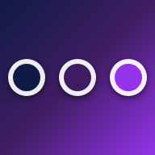
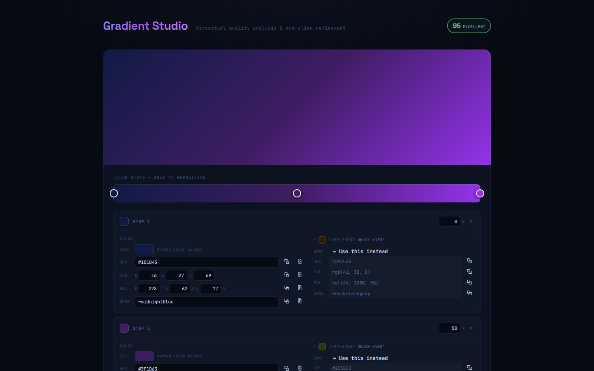
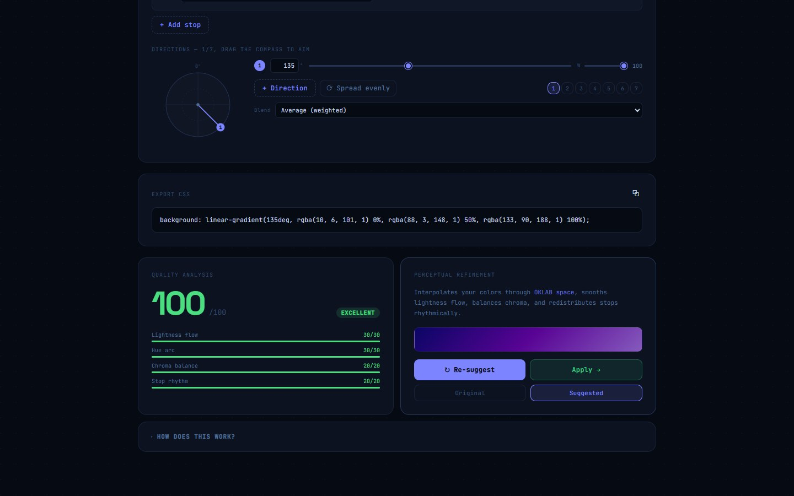
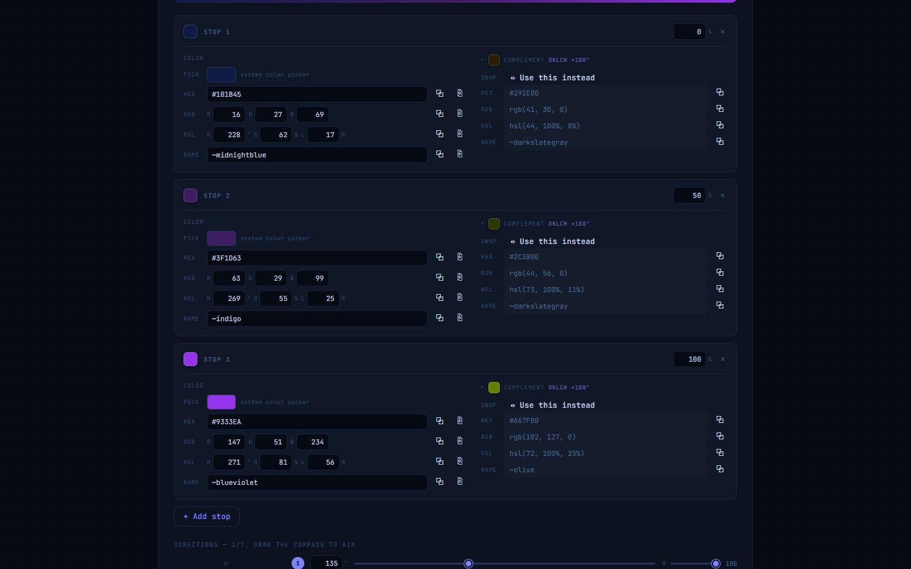
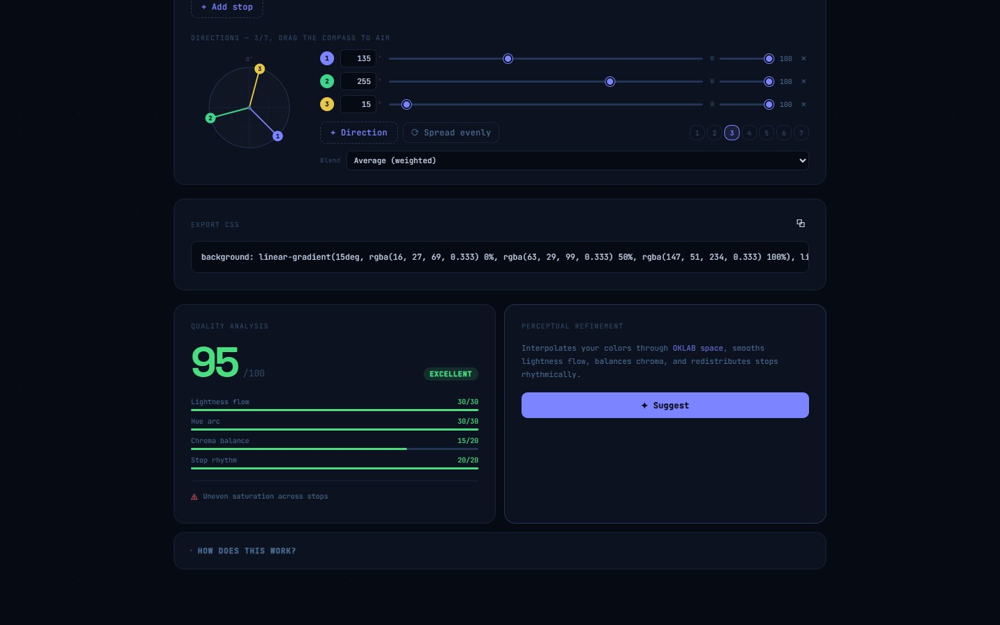

<p align="center">
  
</p>

<h1 align="center">Gradient Studio</h1>

<p align="center"><strong>Build CSS gradients scored by real perceptual colour science.</strong></p>

<p align="center">
  <a href="https://github.com/LightSeek3r/gradient-studio/actions/workflows/ci.yml"></a>
  <a href="LICENSE"></a>
  <a href="CHANGELOG.md"></a>
  
  
</p>

<p align="center">
  <a href="https://gradient-studio-al4.pages.dev/"><strong>Open the app</strong></a> ·
  <a href="https://www.unit42.fr/gradient-studio">Product page on unit42.fr</a> ·
  <a href="CHANGELOG.md">Changelog</a> ·
  <a href="https://github.com/LightSeek3r/gradient-studio/issues">Report an issue</a>
</p>

<table>
  <tr>
    <td width="50%"></td>
    <td width="50%"></td>
  </tr>
  <tr>
    <td width="50%"></td>
    <td width="50%"></td>
  </tr>
</table>

Gradient Studio is a CSS gradient editor for designers and artists. It scores the gradient you
build out of 100 across four perceptual dimensions, computed in
[OKLAB](https://bottosson.github.io/posts/oklab/) so the score follows what the eye sees, names
each issue it finds, and offers a one-click refinement you can compare with your original before
applying it. Every stop is editable in every colour format at once, shows its complementary
colour, and can be projected through up to seven blended directions. The result is one
copy-ready CSS `background` declaration. Free, no account, and it runs entirely in your browser.

**Part of [Unit42](https://www.unit42.fr).** Gradient Studio is built and maintained by
[LightSeek3r](https://github.com/LightSeek3r). The [product page](https://www.unit42.fr/gradient-studio)
(English and French) has the short version; this README is for people who want to run, read or
contribute to the code.

- [Highlights](#highlights)
- [Features](#features)
- [Tech stack](#tech-stack) · [Project structure](#project-structure) · [Getting started](#getting-started)
- [Deployment](#deployment)
- [Contributing](#contributing) · [Security](#security) · [Versions](#versions) · [Licence](#licence)

## Highlights

- **A score out of 100** in four dimensions, with every deduction named as a specific issue.
- **One-click refinement** through OKLAB → LCH, compared side by side before you apply it.
- **Every colour format at once**: picker, hex, RGB, HSL and the nearest of 148 CSS colour names.
- **Complementary colours** at matched lightness and chroma, one click to swap in.
- **Up to 7 directions** blended as an exact weighted mean, or through 8 blend modes.
- **Private by design**: a static page with no server, no analytics and no account.

## Features

### Perceptual quality analysis

Every gradient is scored 0–100 across four dimensions, computed in OKLAB rather than raw sRGB:

- **Lightness flow** (30 pts): lightness reversals, Helmholtz–Kohlrausch brightness wobble
  (saturated colours look brighter than their measured lightness), low-contrast stops, abrupt
  jumps squeezed into a small span, and uneven perceptual speed between stops.
- **Hue arc** (30 pts): rewards a tight hue arc (under 120°) and a consistent rotation direction;
  wide arcs (over 180°) bring unexpected in-between hues.
- **Chroma balance** (20 pts): saturation spikes, a desaturated stop among vivid ones, muddy grey
  midpoints from sRGB interpolation, and 8-bit banding risk.
- **Stop rhythm** (20 pts): stops that fall short of the edges, a transition squeezed into a
  narrow band, or unevenly clustered spacing.

The live score sits in the header and the full breakdown in the **Quality Analysis** panel, with
each issue listed under the bars. **How does this work?** at the bottom of the page summarises
the method.

### One-click perceptual refinement

**✦ Suggest** interpolates your stops through OKLAB → LCH: it smooths the lightness curve
monotonically, compresses the hue arc to keep midpoints clean, applies a gentle chroma envelope and
spaces the stops evenly. Switch between **Original** and **Suggested** to compare, then **Apply**
to keep it, or **Re-suggest** after further edits.

### Every colour format, everywhere

Each stop is editable through the native colour picker, hex, RGB, HSL and the nearest CSS colour
name (148 named colours, with autocomplete), all shown together and kept in sync. Every field has:

- **Paste**: reads any notation from the clipboard (`#4f46e5`, `rgb(79 70 229)`,
  `hsl(243, 69%, 59%)`, `rebeccapurple`, or a bare `79, 70, 229`) and normalises it.
- **Copy**: puts that field's formatted value on the clipboard.

Editing one HSL channel keeps the full precision of the other two, so you can nudge the hue again
and again while saturation and lightness hold steady.

### Complementary colours

Each stop shows its complement: the opposite hue in OKLCH at matched lightness and chroma, brought
back into the sRGB gamut by reducing chroma, so the hue stays true. Copy it in any format, or
press **Use this instead** to swap it into the stop.

### Multi-angle gradients

Project the same stops through up to **7 directions** at once, aimed with a draggable compass or
per-direction angle and weight sliders, with presets for 1 to 7 directions and **Spread evenly**.
In the default **Average (weighted)** blend each layer's opacity is `wₖ / (w₁+…+wₖ)`, painted
back to front, which makes the composite the exact weighted mean of every direction. Eight
`background-blend-mode`s (screen, multiply, overlay, soft-light, hard-light, difference, lighten,
darken) give more painterly composites. Each direction can be muted, reweighted or removed.

### Export

**Export CSS** always shows the exact `background` (plus `background-blend-mode` when a blend mode
is in use) for the current stops, directions, weights and blend, with a copy button.

## Tech stack

- [React](https://react.dev) 19 + TypeScript 5.9, built with [Vite](https://vite.dev) 7, with the
  React Compiler enabled through `babel-plugin-react-compiler`.
- All colour maths, scoring and suggestion logic is plain TypeScript in this repository: the only
  runtime dependencies are React and the two self-hosted fonts (Space Grotesk and JetBrains Mono,
  via Fontsource).
- ESLint 9 with `typescript-eslint` and the React Hooks rules.

## Project structure

```
src/
  gradient-engine.ts     OKLAB/OKLCH conversions, the quality scorer, the suggestion engine,
                         and CSS composition (single angle and multi-direction)
  color-formats.ts       hex/RGB/HSL/named-colour parsing and formatting, the 148 CSS colour
                         names, gamut mapping and complementary colours
  clipboard.ts           clipboard read/write with a fallback; every call resolves, never throws
  components/
    StopCard.tsx           the per-stop editor (all formats, complement, swap)
    DirectionsPanel.tsx    the compass, direction rows, presets and blend mode
    fields.tsx             shared copy/paste buttons and format-aware inputs
  App.tsx                top-level state and layout
  App.css, index.css     styles
public/                  favicon, app icons, web manifest and the Open Graph image
docs/                    the README screenshots and the repository's social preview image
index.html               page shell, meta description, Open Graph and Twitter Card tags
```

## Getting started

You need Node.js 24 (what CI runs) and npm.

```bash
git clone https://github.com/LightSeek3r/gradient-studio.git
cd gradient-studio
npm ci
npm run dev       # Vite dev server on http://localhost:5173
npm run lint      # ESLint
npm run build     # type-check (tsc -b) and build into dist/
npm run preview   # serve the production build on http://localhost:4173
```

There is no configuration, no environment variable and no backend: `npm run build` produces a
static site in `dist/` that any static host can serve.

## Deployment

The [live app](https://gradient-studio-al4.pages.dev/) is the `dist/` build hosted on Cloudflare
Pages, deployed separately from this repository. GitHub runs no deploy: the only workflow is CI,
and the `v*` tags are release markers.

`index.html` points its `canonical`, `og:url`, `og:image` and `twitter:image` tags at
`https://gradient-studio-al4.pages.dev/`. If you host your own copy, change them to your address,
because link previews need absolute URLs.

## Contributing

Bug reports, ideas and small pull requests are welcome. Please read
[CONTRIBUTING.md](CONTRIBUTING.md) first: it lists the checks CI runs. Questions can go in an
[issue](https://github.com/LightSeek3r/gradient-studio/issues) too. This project follows the
[Code of Conduct](CODE_OF_CONDUCT.md).

## Security

Please report vulnerabilities privately, as described in [SECURITY.md](SECURITY.md). The app has
no server, no account and no secrets, and the repository holds none.

## Versions

The version in `package.json` and the `vX.Y.Z` git tags follow [Semantic Versioning](https://semver.org)
loosely while the project is 0.x. Notable changes are listed in [CHANGELOG.md](CHANGELOG.md) and
each tag has a [GitHub release](https://github.com/LightSeek3r/gradient-studio/releases).

## Licence

Released under the [MIT licence](LICENSE). The CSS you export with the app is yours to use however
you like. The bundled fonts, Space Grotesk and JetBrains Mono, keep their own licence, the SIL Open
Font License 1.1.
